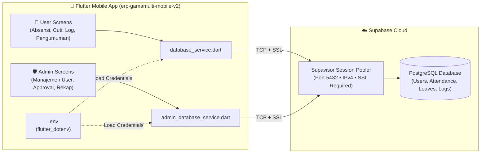

# Gama Multi ERP Mobile v2

Aplikasi mobile Enterprise Resource Planning (ERP) internal berbasis **Flutter** untuk manajemen operasional karyawan dan administrator **Gama Multi Usaha Mandiri (GMUM)**, terintegrasi langsung dengan database **PostgreSQL (Supabase)**.

---

## Unduh & Instalasi Aplikasi (Android)

> **Link Alternatif:** [Klik di sini untuk mengunduh file .apk](GANTI_DENGAN_LINK_APK_KAMU_DI_SINI)

### Cara Instalasi di Perangkat Android:

1. Unduh file **`app-release.apk`** melalui tombol atau link di atas.
2. Buka file `.apk` yang telah diunduh melalui _File Manager_ atau notifikasi browser.
3. Jika muncul peringatan keamanan, aktifkan izin **"Install from Unknown Sources"** (_Izinkan dari sumber ini_).
4. Ketuk **Install** dan tunggu proses selesai.

---

## Arsitektur Sistem

Aplikasi ini menghubungkan lapisan layanan database Flutter (`database_service.dart` & `admin_database_service.dart`) langsung ke instance PostgreSQL **Supabase** melalui **Supavisor Session Pooler** dengan koneksi terenkripsi SSL.

