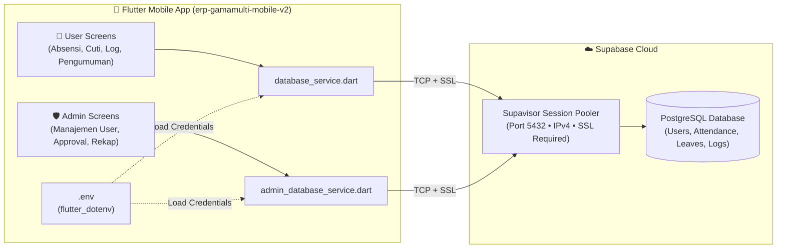

# Gama Multi ERP Mobile v2


Aplikasi mobile Enterprise Resource Planning (ERP) internal berbasis **Flutter** untuk manajemen operasional karyawan dan administrator **Gama Multi Usaha Mandiri (GMUM)**, terintegrasi langsung dengan database **PostgreSQL (Supabase)**.

---

## 📱 Unduh & Instalasi Aplikasi (Android)

[](GANTI_DENGAN_LINK_APK_KAMU_DI_SINI)

> **Link Alternatif:** [Klik di sini untuk mengunduh file .apk](GANTI_DENGAN_LINK_APK_KAMU_DI_SINI)

### Cara Instalasi di Perangkat Android:
1. Unduh file **`app-release.apk`** melalui tombol atau link di atas.
2. Buka file `.apk` yang telah diunduh melalui *File Manager* atau notifikasi browser.
3. Jika muncul peringatan keamanan, aktifkan izin **"Install from Unknown Sources"** (*Izinkan dari sumber ini*).
4. Ketuk **Install** dan tunggu proses selesai.

---

## 🏗️ Arsitektur Sistem

Aplikasi ini menghubungkan lapisan layanan database Flutter (`database_service.dart` & `admin_database_service.dart`) langsung ke instance PostgreSQL **Supabase** melalui **Supavisor Session Pooler** dengan koneksi terenkripsi SSL.



---

## ✨ Fitur Utama

### 👤 Modul Karyawan (User)
* **Autentikasi:** Registrasi akun baru dan login dengan verifikasi *password hash* (`bcrypt`).
* **Presensi / Absensi:** Pencatatan kehadiran harian dan riwayat absensi lengkap.
* **Manajemen Cuti & Izin Sakit:** Pengajuan cuti tahunan, pengajuan izin sakit beserta detail, serta pemantauan status persetujuan.
* **Log Aktivitas Harian:** Pencatatan detail pekerjaan harian, penambahan log baru, dan riwayat aktivitas.
* **Pengumuman Perusahaan:** Melihat informasi dan pengumuman terbaru dari manajemen.
* **Profil & Ekspor Data:** Pengelolaan profil pengguna serta fitur ekspor laporan.

### 🛡️ Modul Administrator (Admin)
* **Dashboard Admin:** Ringkasan aktivitas operasional dan monitoring data karyawan.
* **Manajemen Pengguna:** Kelola data akun karyawan, hak akses (*role*), dan status aktif.
* **Monitoring Absensi:** Rekapitulasi dan pemantauan kehadiran seluruh karyawan.
* **Persetujuan Cuti & Izin:** Tinjau, setujui, atau tolak pengajuan cuti/sakit karyawan.
* **Audit Log Aktivitas:** Pantau seluruh log aktivitas kerja karyawan.
* **Manajemen Pengumuman:** Buat, ubah, dan publikasikan pengumuman internal.
* **Ekspor Laporan Admin:** Unduh rekap data operasional untuk kebutuhan administrasi.

---

## 📂 Struktur Direktori

```text
erp-gamamulti-mobile-v2/
├── lib/
│   ├── announcements/          # Layar detail pengumuman
│   ├── services/               # Koneksi PostgreSQL Supabase & layanan ekspor
│   │   ├── database_service.dart
│   │   ├── admin_database_service.dart
│   │   ├── export_service.dart
│   │   └── admin_export_service.dart
│   ├── theme/                  # Konfigurasi tema dan warna aplikasi
│   ├── views/
│   │   ├── activity_log/       # Fitur catatan aktivitas harian
│   │   ├── admin/              # Halaman khusus dashboard & manajemen admin
│   │   ├── attendance/         # Fitur presensi & riwayat kehadiran
│   │   ├── auth/               # Login, register, dan penanganan error koneksi
│   │   ├── home/               # Beranda utama karyawan
│   │   ├── leave/              # Pengajuan & riwayat cuti serta izin sakit
│   │   ├── navigation/         # Navigasi utama aplikasi
│   │   ├── profile/            # Halaman profil pengguna
│   │   └── splash/             # Splash screen awal
│   ├── widgets/                # Komponen UI reusable (snackbar, tombol ekspor)
│   └── main.dart               # Entry point aplikasi
├── DATABASE_SCHEMA.sql         # Skema tabel utama database
├── ADMIN_DDL.sql               # Skema tabel & DDL khusus admin
└── pubspec.yaml                # Daftar dependensi Flutter
```

---

## 🚀 Cara Menjalankan Proyek (Mode Developer)

### 1. Prasyarat
* [Flutter SDK](https://docs.flutter.dev/get-started/install) (versi 3.x atau terbaru)
* Dart SDK
* Akun dan proyek aktif di [Supabase](https://supabase.com/)

### 2. Clone Repositori
```bash
git clone https://github.com/ramonnpp/erp-gamamulti-mobile-v2.git
cd erp-gamamulti-mobile-v2
```

### 3. Persiapan Database di Supabase
1. Buat proyek baru di dashboard Supabase.
2. Aktifkan ekstensi `pgcrypto` melalui menu **Database > Extensions**.
3. Jalankan skrip `DATABASE_SCHEMA.sql` dan `ADMIN_DDL.sql` di **SQL Editor** Supabase untuk membentuk seluruh struktur tabel.
4. Aktifkan **Row Level Security (RLS)** pada tabel sensitif (seperti `users`) untuk mencegah akses tidak sah dari REST API publik.

### 4. Konfigurasi Environment (`.env`)
Buat file `.env` di direktori *root* proyek dan isi menggunakan kredensial **Session Pooler** dari dashboard Supabase:

```env
DB_HOST=aws-0-ap-southeast-1.pooler.supabase.com
DB_PORT=5432
DB_NAME=postgres
DB_USER=postgres.[project-ref]
DB_PASSWORD=password_database_supabase_anda
```

### 5. Instalasi Dependensi & Menjalankan Aplikasi
```bash
flutter pub get
flutter run
```

### 6. Build APK Release
```bash
flutter build apk --release
```
File APK siap instal akan tersimpan di `build/app/outputs/flutter-apk/app-release.apk`.

---

## 🔒 Catatan Keamanan

* **Kerahasiaan `.env`:** File `.env` menyimpan kredensial koneksi database utama dan sudah didaftarkan di dalam `.gitignore`. **Jangan pernah** meng-commit atau mengunggah file `.env` ke repositori publik.
* **Koneksi SSL Wajib:** Seluruh komunikasi antara aplikasi Flutter dan Supavisor Session Pooler Supabase wajib menggunakan enkripsi SSL (`SslMode.require`).
* **Perlindungan Row Level Security (RLS):** Pastikan fitur RLS selalu aktif di seluruh tabel skema `public` pada Supabase agar tabel dan *hash* password pengguna tidak dapat diakses melalui REST API publik (`anon` key).
* **Distribusi Internal:** Karena aplikasi terhubung langsung ke database PostgreSQL internal, distribusikan file `.apk` hanya kepada karyawan resmi perusahaan.
